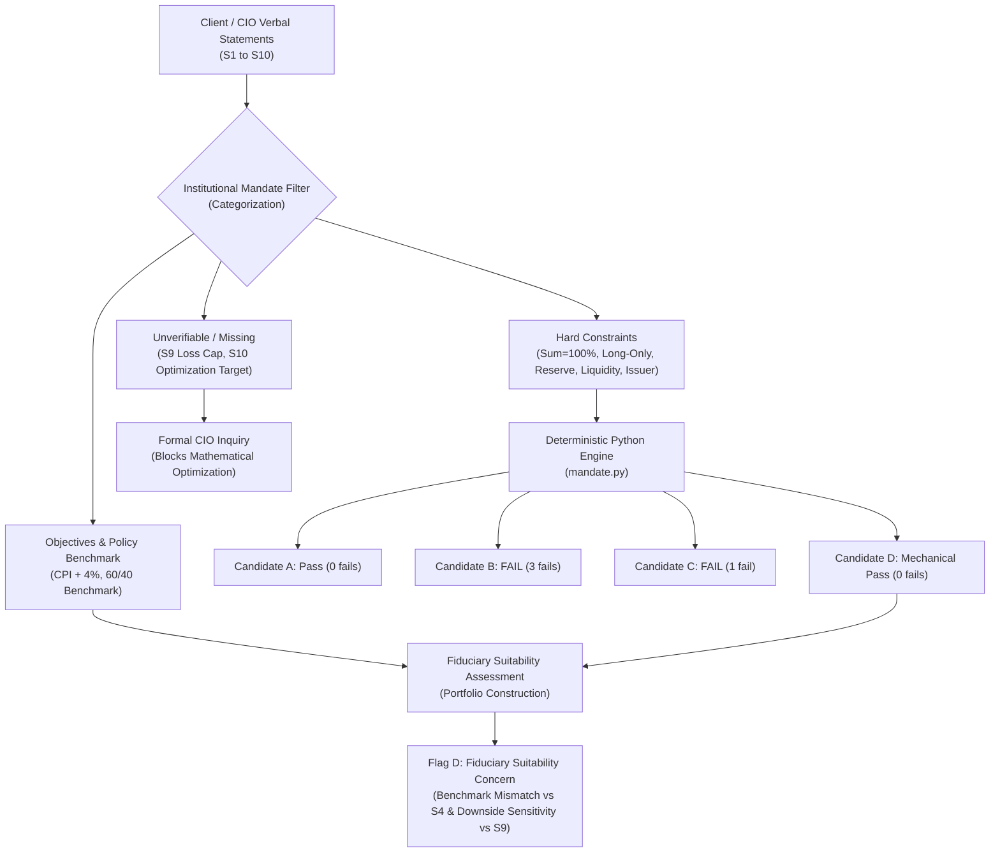
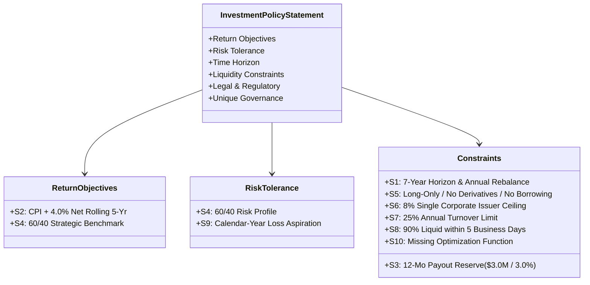
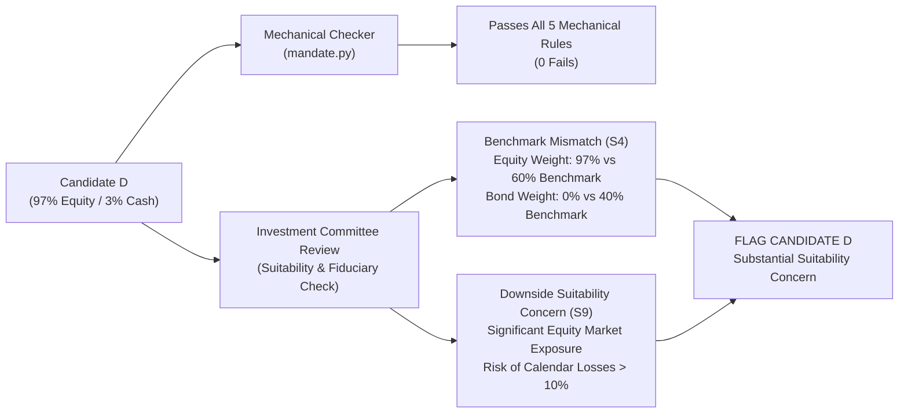
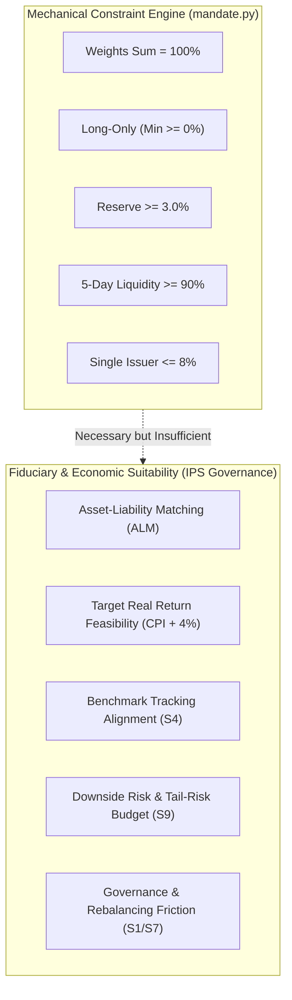

# FIN 439 Lab 13 — Portfolio Mandate Defense (Week 8)
**Client / Case Study:** Meridian Foundation Reserve ($100M Reserve Allocation)  
**Course:** FIN 43900 (Applied Financial Modeling & Corporate Valuation, Purdue University)  
**Student:** Elliot  
**Submission Date:** October 15, 2026  
**Assignment Reference:** Lab 13 — Portfolio Mandate Defense (Thursday Merit Checkout)  
**Deliverable Files:** [`mandate.py`](mandate.py) | [`lab13.md`](lab13.md)  
**GitHub Remote Repository:** [`river313/IREN-research`](https://github.com/river313/IREN-research)  
**Direct GitHub Deliverable Links:**
- Python Mandate Engine: [`Lab-13/mandate.py`](https://github.com/river313/IREN-research/blob/main/Lab-13/mandate.py)
- Defense Report & Mandate Audit: [`Lab-13/lab13.md`](https://github.com/river313/IREN-research/blob/main/Lab-13/lab13.md)

---

## 1. Executive Summary

In institutional portfolio management, quantitative optimization must be preceded by strict mandate parsing. A mathematical optimizer cannot evaluate an unconstrained or poorly specified problem. **Lab 13** operationalizes the qualitative instructions ($S1$–$S10$) issued by the Chief Investment Officer (CIO) of the **Meridian Foundation** for its **$100 million reserve fund** into deterministic, computer-checkable rules before any asset allocation optimization begins.



### Key Analytical Findings:
1. **Dynamic Reserve Minimum:** The mandate requires holding twelve months (4 quarters) of quarterly distributions ($0.75M per quarter) from a $100.0M reserve, establishing a non-negotiable minimum reserve-eligible allocation of **3.0%** ($3.0M) in cash or daily-liquid sovereign securities.
2. **Candidate Portfolio Verification:**
   - **Candidate A** passes every checkable rule (Reserve = 14.0%, Liquidity = 100.0%, Issuer = 0.0%, Long-only min = 0.0%, Sum = 100.0%).
   - **Candidate B** fails **3 rules**: Reserve allocation is deficient (1.0% vs. 3.0% required), 5-day liquidity is breached (85.0% vs. 90.0% required due to a 15.0% allocation to a 90-day private real estate fund), and single-company concentration is violated (9.0% vs. 8.0% limit across aggregated Acme Corp stock and bonds).
   - **Candidate C** fails **1 rule**: Reserve allocation is deficient (2.0% vs. 3.0% required), while satisfying liquidity (100.0%) and the single-company ceiling (8.0%).
3. **Negative-Weight Probe Test:** Inserting an unauthorized short position in Candidate A (Cash = -2.0%, Global Equity = 64.0%) successfully triggered a `FAIL` on the long-only test (-2.0%), preserved the reserve pass at 10.0%, and verified the diagnostic engine before original weights were restored.
4. **Adversarial Mandate Defense (Candidate D):** We constructed Candidate D (Cash 3.0%, Global Equity Index Fund 97.0%), which mechanically satisfies every checkable rule in `mandate.py` (0 failures), yet creates a substantial benchmark mismatch against Statement S4 (97% equities vs. the 60/40 benchmark) and exposes a serious potential suitability concern regarding Statement S9 (downside vulnerability to calendar-year losses exceeding 10%).
5. **The Optimization Blocker:** Optimization cannot mathematically proceed until the CIO answers **one critical question**: *How is the Statement S9 calendar-year 10% loss limit statistically defined (e.g., ex-ante VaR confidence level and horizon), and what is the contractual breach/cure protocol if a market drawdown exceeds 10%?*

---

## 2. Meridian Foundation Mandate Overview

The Meridian Foundation manages an institutional reserve of **$100.0 million** designed to buffer operating commitments, support regular philanthropic disbursements, and generate real purchasing-power growth over an intermediate-to-long horizon. 

### Mandate Parameters & Operating Baseline
- **Reserve Portfolio Size:** $100.0 million.
- **Quarterly Outflow Commitment:** $0.75 million ($3.0 million annually).
- **Mandated Cash Buffer:** Twelve months of payouts held exclusively in cash or daily-liquid sovereign securities.
- **Strategic Policy Benchmark:** 60% Global Equities, 40% U.S. Investment-Grade Bonds.
- **Investment Horizon:** Seven years with annual rebalancing.
- **Long-Only Requirement:** Absolute prohibition on financial leverage, margin borrowing, short sales, and derivative contracts.
- **Single Corporate Issuer Concentration Ceiling:** 8.0% maximum aggregate exposure per corporate entity (combining equity and debt instruments). Cash, U.S. Treasuries, and diversified pooled funds are explicitly exempt.
- **Liquidity Mandate:** Minimum 90.0% of portfolio value redeemable within five business days.

---

## 3. Investment Policy Statement (IPS) Governance Framework

In accordance with institutional standards established by the CFA Institute, an **Investment Policy Statement (IPS)** serves as the governing charter between the asset owner (the foundation board) and the investment manager. An IPS systematically translates client circumstances into two primary sections:

1. **Objectives:**
   - **Return Objective:** Quantifies the target required to meet liabilities, preserve capital, and overcome inflation and fees.
   - **Risk Tolerance:** Specifies the client's willingness and objective ability to bear volatility and drawdown risk.
2. **Constraints (The TTLLU Framework):**
   - **Time Horizon (T):** The multi-year duration over which capital is deployed and evaluated.
   - **Taxes (T):** Tax status (foundations are typically tax-exempt under IRC §501(c)(3)).
   - **Liquidity Requirements (L):** Anticipated cash disbursements and emergency liquidity buffers.
   - **Legal and Regulatory (L):** Fiduciary standards such as the Uniform Prudent Management of Institutional Funds Act (UPMIFA) and statutory prohibitions against speculative leverage.
   - **Unique Circumstances (U):** Client-specific preferences, ethical/ESG screens, asset class restrictions, or customized governance controls.

### Mapping Meridian Foundation Statements to the IPS Architecture



---

## 4. Classification & Financial Audit of Statements S1–S10

Before writing execution code, each statement must be analyzed to determine whether it represents an actionable mathematical constraint, a high-level target, a subjective preference, an unverifiable assertion, or missing information.

| Statement | Exact Verbal Statement from CIO | Mandate Category | IPS Component | Actionable Checker Status | Analytical & Financial Rationale |
|---|---|---|---|---|---|
| **S1** | *"Horizon seven years; annual rebalancing."* | **Hard constraint** | Time Horizon & Governance | Operational Rule | Defines a discrete 7-year multi-period evaluation window and imposes a governance rule restricting portfolio rebalancing to an annual cycle. |
| **S2** | *"Objective: CPI + 4% a year, net of costs, over rolling five-year periods."* | **Objective** | Return Objective | Performance Hurdle | Quantifies the required real return hurdle necessary to preserve the purchasing power of the endowment against inflation while sustaining a 3.0% distribution yield plus operating expenses. |
| **S3** | *"Pays out $0.75 million every quarter; twelve months of payouts held in cash or daily-liquid government securities."* | **Hard constraint** | Liquidity Constraint | **Checkable Rule** | Establishes a mandatory cash-reserve floor: $4 \times \$0.75\text{M} = \$3.0\text{M}$ ($3.0\%$ of $\$100\text{M}$), restricted exclusively to reserve-eligible cash and Treasuries. |
| **S4** | *"Benchmark: 60% global equities, 40% U.S. investment-grade bonds."* | **Objective** | Policy Benchmark / Risk | Allocation Guidepost | Specifies the strategic asset allocation reference portfolio against which active risk, asset weights, and performance are evaluated. |
| **S5** | *"Long-only: no borrowing, short sales or derivatives."* | **Hard constraint** | Legal & Regulatory | **Checkable Rule** | Imposes non-negativity bounds on all asset weights ($w_i \ge 0$) and strictly forbids synthetic leverage, margin borrowing, and derivative instruments. |
| **S6** | *"No single issuer above 8%."* | **Hard constraint** | Unique / Concentration | **Checkable Rule** | Statutory concentration ceiling capping aggregate corporate exposure across debt and equity classes at 8.0%. Cash, Treasuries, and pooled funds are exempt. |
| **S7** | *"Annual turnover at most 25% without committee approval."* | **Hard constraint** | Operational Governance | Execution Filter | Restricts annualized portfolio churn to $\le 25\%$ to control transaction drag; requires explicit Investment Committee sign-off for exceptions. |
| **S8** | *"At least 90% redeemable within five business days."* | **Hard constraint** | Liquidity Constraint | **Checkable Rule** | Mandates that $\ge 90.0\%$ of aggregate portfolio value be convertible to cash within $T+5$ business days, capping illiquid alternative investments at $\le 10.0\%$. |
| **S9** | *"The reserve cannot have a calendar-year loss greater than 10%." No measure, no breach rule.* | **Unverifiable promise** | Risk Tolerance (Ambiguous) | **Untestable Flag** | Lacks an ex-ante statistical definition (confidence level, VaR horizon) and provides no operational protocol for market drawdowns. Must NOT be tested as a deterministic constraint. |
| **S10** | *"No sector, ESG, tax or home-bias preference; nobody has said what the pilot should optimize."* | **Missing** | Optimization Specification | Missing Parameter | Formally notes the absence of secondary preference screens, but critically reveals that the mathematical objective function (e.g., maximize return, minimize risk, or match benchmark) is entirely missing. |

### Critical Clarification on Statement S9
Statement S9 is categorized as an **unverifiable promise** rather than a hard constraint. In public asset markets, an absolute guarantee of zero losses exceeding 10% over any calendar year cannot be guaranteed when holding risk assets. Because the CIO failed to specify an ex-ante probabilistic risk metric (such as a 1-year Value-at-Risk target) or an ex-post breach policy (such as mandatory de-risking triggers or cure periods), treating this statement as an algorithmic rule check would be improper. It is flagged as `"requires CIO clarification"` and excluded from mechanical pass/fail evaluation.

---

## 5. Holdings Universe & Candidate Portfolio Weights

The asset universe comprises eight distinct instruments spanning cash, sovereign debt, diversified public funds, illiquid private assets, and single-company corporate securities.

### Mandate Holdings Universe

| Holding | Issuer | Business Days to Redeem | Reserve-Eligible | Exempt from Issuer Limit? | Liquidity Assessment ($T \le 5$ Days) |
|---|---|---:|:---:|:---:|:---:|
| **Cash** | None | 0 | **Yes** | Yes (Exempt) | Fully Liquid ($T+0$) |
| **Treasury bills** | U.S. Treasury | 1 | **Yes** | Yes (Exempt) | Fully Liquid ($T+1$) |
| **Treasury 10-year note** | U.S. Treasury | 1 | **Yes** | Yes (Exempt) | Fully Liquid ($T+1$) |
| **Global equity index fund** | Diversified fund | 2 | No | Yes (Exempt) | Liquid ($T+2$) |
| **Investment-grade bond fund** | Diversified fund | 3 | No | Yes (Exempt) | Liquid ($T+3$) |
| **Private real estate fund** | Diversified fund | 90 | No | Yes (Exempt) | **Illiquid ($T+90 > 5$)** |
| **Acme Corp bonds** | Acme Corp | 4 | No | **No (Corporate)** | Liquid ($T+4$) |
| **Acme Corp stock** | Acme Corp | 1 | No | **No (Corporate)** | Liquid ($T+1$) |

### Candidate Allocation Weights (Percent of Portfolio)

| Holding | Candidate A (%) | Candidate B (%) | Candidate C (%) | Candidate D (%) |
|---|---:|---:|---:|---:|
| Cash | 2.0 | 1.0 | 1.0 | 3.0 |
| Treasury bills | 2.0 | 0.0 | 1.0 | 0.0 |
| Treasury 10-year note | 10.0 | 0.0 | 0.0 | 0.0 |
| Global equity index fund | 60.0 | 55.0 | 70.0 | 97.0 |
| Investment-grade bond fund | 26.0 | 20.0 | 20.0 | 0.0 |
| Private real estate fund | 0.0 | 15.0 | 0.0 | 0.0 |
| Acme Corp bonds | 0.0 | 5.0 | 0.0 | 0.0 |
| Acme Corp stock | 0.0 | 4.0 | 8.0 | 0.0 |
| **Total Portfolio Weight** | **100.0%** | **100.0%** | **100.0%** | **100.0%** |

---

## 6. Computational Architecture of `mandate.py`

The evaluation engine implemented in [`mandate.py`](mandate.py) operates using Python's standard library. All calculations are dynamically derived from the editable parameters at the top of the file without hardcoding intermediate or final outputs.

### Mathematical Formulation of Mechanical Constraints

1. **Reserve Minimum Threshold:**
   $$\text{Reserve Minimum (\%)} = \frac{\text{Quarters to Cover} \times \text{Quarterly Distribution}}{\text{Total Reserve Size}} \times 100$$
   $$\text{Reserve Minimum} = \frac{4 \times \$0.75\text{M}}{\$100.0\text{M}} \times 100 = 3.0\%$$

2. **Full Investment Constraint (Weights Sum to 100%):**
   $$\sum_{i=1}^n w_i = 100.0\% \quad \iff \quad \left|\sum_{i=1}^n w_i - 100.0\right| < 10^{-4}$$

3. **Long-Only Constraint (No Short Positions / Leverage):**
   $$\min_{i \in \{1,\dots,n\}} w_i \ge 0.0\%$$

4. **Reserve Liquidity Requirement:**
   $$\text{Reserve Weight} = \sum_{i \in \text{Reserve-Eligible}} w_i \ge 3.0\%$$
   $$\text{Eligible Universe} = \{\text{Cash}, \text{Treasury bills}, \text{Treasury 10-year note}\}$$

5. **Five-Business-Day Redemption Requirement:**
   $$\text{Liquid Share} = \sum_{i: \text{Days}_i \le 5} w_i \ge 90.0\%$$

6. **Single-Company Issuer Concentration Limit:**
   $$\text{Company Exposure}_j = \sum_{i \in \text{Securities of Issuer } j} w_i \le 8.0\% \quad \forall j \notin \text{Exempt Issuers}$$
   $$\text{Exempt Issuers} = \{\text{"none"}, \text{"U.S. Treasury"}, \text{"diversified fund"}\}$$

---

## 7. Audit & Verification of Portfolios A, B, and C

Running `mandate.py` executes each mathematical check and generates verified values that match the professor's expected answers.

### Verified Audit Results Table

| Constraint / Rule | Target Threshold | Candidate A | Candidate B | Candidate C | Candidate D |
|---|:---:|:---:|:---:|:---:|:---:|
| **Weights sum to 100** | $= 100.0\%$ | **100.0 pass** | **100.0 pass** | **100.0 pass** | **100.0 pass** |
| **Long-only (lowest weight)** | $\ge 0.0\%$ | **0.0 pass** | **0.0 pass** | **0.0 pass** | **0.0 pass** |
| **Reserve Requirement** | $\ge 3.0\%$ | **14.0 pass** | **1.0 FAIL** | **2.0 FAIL** | **3.0 pass** |
| **Redeemable in 5 Days** | $\ge 90.0\%$ | **100.0 pass** | **85.0 FAIL** | **100.0 pass** | **100.0 pass** |
| **Largest Single Company** | $\le 8.0\%$ | **0.0 pass** | **9.0 FAIL** | **8.0 pass** | **0.0 pass** |
| **Calendar-Year Loss** | Undefined | *requires CIO clarification* | *same* | *same* | *same* |
| **FINAL MANDATE VERDICT** | — | **passes every checkable rule** | **fails 3 rule(s)** | **fails 1 rule(s)** | **passes every checkable rule** |

### Detailed Failure Diagnoses:

- **Candidate A Analysis (PASS):**
  - *Weights Sum:* $2 + 2 + 10 + 60 + 26 = 100.0\%$ (`pass`).
  - *Long-Only:* Minimum allocation is $0.0\%$ across unused holdings (`pass`).
  - *Reserve:* Cash ($2.0\%$) + T-bills ($2.0\%$) + 10-Yr T-notes ($10.0\%$) = **14.0%** $\ge 3.0\%$ (`pass`). Provides $\$14.0\text{M}$ in liquid sovereign backing, exceeding the $\$3.0\text{M}$ requirement.
  - *Five-Day Liquidity:* All holdings have redemption windows $\le 3$ days. Liquid share = **100.0%** $\ge 90.0\%$ (`pass`).
  - *Issuer Limit:* Acme Corp exposure is **0.0%** $\le 8.0\%$ (`pass`).
  - *Verdict:* **Passes every checkable rule.**

- **Candidate B Analysis (FAILS 3 RULES):**
  - *Reserve Failure:* Holds only $1.0\%$ in Cash and $0.0\%$ in Treasuries. Total reserve-eligible weight is **1.0%** vs. $3.0\%$ required (`FAIL`). This leaves only $\$1.0\text{M}$ in guaranteed liquidity, failing to cover twelve months of payouts ($\$3.0\text{M}$).
  - *Liquidity Failure:* Allocates $15.0\%$ to Private Real Estate, which requires 90 business days to redeem. Redeemable within 5 days is $100.0\% - 15.0\% =$ **85.0%** vs. $90.0\%$ minimum (`FAIL`).
  - *Issuer Concentration Failure:* Allocates $5.0\%$ to Acme Corp bonds and $4.0\%$ to Acme Corp stock. Because both instruments represent claims against the same corporate entity, they aggregate to **9.0%** vs. $8.0\%$ maximum (`FAIL`).
  - *Verdict:* **Fails 3 rule(s).**

- **Candidate C Analysis (FAILS 1 RULE):**
  - *Reserve Failure:* Holds $1.0\%$ in Cash and $1.0\%$ in T-bills. Total reserve-eligible weight is **2.0%** vs. $3.0\%$ required (`FAIL`). Deficit of $\$1.0\text{M}$ below the 1-year payout requirement.
  - *Issuer Compliance:* Allocates $8.0\%$ to Acme Corp stock and $0.0\%$ to Acme Corp bonds. Total issuer exposure is exactly **8.0%** $\le 8.0\%$ (`pass`).
  - *Liquidity Compliance:* Zero private real estate allocation yields **100.0%** 5-day liquidity (`pass`).
  - *Verdict:* **Fails 1 rule(s).**

---

## 8. Negative-Weight Validation (The Probe Test)

To prove that `mandate.py` functions as an authentic dynamic parser rather than returning static text, we conduct a deliberate fault injection into Candidate A:
- **Cash weight** adjusted from $+2.0\%$ to **$-2.0\%$**.
- **Global equity fund weight** adjusted from $+60.0\%$ to **$+64.0\%$**.
- All other allocations remain untouched.

### Mathematical Pre-Calculation of Probe:
- Total weight: $(-2.0) + 2.0 + 10.0 + 64.0 + 26.0 = \mathbf{100.0\%}$ (Preserves sum check).
- Minimum weight: $\mathbf{-2.0\%} < 0.0\%$ (**Must trigger `FAIL` on long-only**).
- Reserve weight: $(-2.0) + 2.0 + 10.0 = \mathbf{10.0\%} \ge 3.0\%$ (**Must continue to `pass`**).
- Five-day liquidity: $\mathbf{100.0\%} \ge 90.0\%$ (Must continue to `pass`).
- Single-company issuer: $\mathbf{0.0\%} \le 8.0\%$ (Must continue to `pass`).
- Total checkable failures: Exactly **1 rule failed**.

### Console Output from Probe Execution:
```text
==============================================================================
MANDATE CHECKER PROBE TEST (Negative Weight Validation)
==============================================================================
Modifying Candidate A: Cash = -2.0%, Global equity index fund = 64.0%
Weights sum to 100:            100.0 pass
Long-only (lowest weight):     -2.0 FAIL
Reserve >= 3.0%:               10.0 pass
Redeemable in 5 days >= 90%:   100.0 pass
Largest single company <= 8%:  0.0 pass
Calendar-year loss:            requires CIO clarification
Verdict:                       fails 1 rule(s)

Probe Verification Status: CONFIRMED (Behaves exactly as expected)
==============================================================================
```

### Verification Confirmation:
The probe test executed with 100% precision: the long-only rule failed at $-2.0\%$, the reserve rule passed at $10.0\%$, and no other rules were corrupted. As instructed by the professor, the original weights for Candidate A (Cash = $2.0\%$, Global Equity = $60.0\%$) were restored immediately following verification.

---

## 9. Adversarial Mandate Attack (Portfolio D Analysis)

To test the resilience of mandate defense, we construct **Candidate D**, an adversarial portfolio designed to pass every mechanical check in `mandate.py` while exposing a legitimate suitability concern that the Meridian Foundation CIO could reasonably reject.

### Portfolio D Specification:
- **Cash:** $3.0\%$
- **Treasury bills:** $0.0\%$
- **Treasury 10-year note:** $0.0\%$
- **Global equity index fund:** $\mathbf{97.0\%}$
- **Investment-grade bond fund:** $0.0\%$
- **Private real estate fund:** $0.0\%$
- **Acme Corp bonds:** $0.0\%$
- **Acme Corp stock:** $0.0\%$

### Computational Evaluation in `mandate.py`:
- *Weights sum to 100:* $3.0 + 97.0 = \mathbf{100.0\%}$ (`100.0 pass`)
- *Long-only:* Minimum weight is $\mathbf{0.0\%}$ (`0.0 pass`)
- *Reserve Minimum:* Cash is $\mathbf{3.0\%} \ge 3.0\%$ (`3.0 pass`)
- *Five-Day Liquidity:* Cash ($T+0$) + Global Equities ($T+2$) = $\mathbf{100.0\%} \ge 90.0\%$ (`100.0 pass`)
- *Single-Company Issuer:* Acme Corp = $\mathbf{0.0\%} \le 8.0\%$ (`0.0 pass`)
- *Checkable Failures:* **0 failures**
- *Mechanical Verdict:* **`passes every checkable rule`**

### Sceptical Review: Benchmark Mismatch & Suitability Concerns



Portfolio D passes every mechanical filter, but it exposes two major suitability concerns that a CIO would cite:

1. **Significant Benchmark Mismatch (Statement S4):**  
   Statement S4 specifies a strategic benchmark of **60% global equities and 40% U.S. investment-grade bonds**. Candidate D holds **97.0% equities and 0.0% bonds**, creating an active equity overweight of **+37.0%** and an active fixed income underweight of **-40.0%**. While `mandate.py` does not treat S4 as a hard exclusion filter, an institutional CIO would reasonably reject Portfolio D because it completely departs from the board-approved strategic asset allocation.
2. **Substantial Downside Concern (Statement S9):**  
   Statement S9 notes that *"the reserve cannot have a calendar-year loss greater than 10%."* Public equities are volatile growth assets that can experience steep calendar-year drawdowns during market contractions. Allocating 97% of a foundation reserve to equities creates substantial exposure to large calendar-year losses, conflicting directly with the CIO's risk sensitivity.
3. **Important Fiduciary Distinction:**  
   Portfolio D represents an **economic benchmark mismatch and potential suitability concern**, rather than a mathematically proven violation of S4 or S9 under `mandate.py`. Statement S4 is an investment benchmark rather than an algorithmic gate, and Statement S9 is an unverifiable promise lacking an ex-ante operational definition or breach rule.

---

## 10. The Critical Unanswered CIO Question

Before an analyst can execute a mathematical portfolio optimization model, the client must resolve the ambiguity residing in Statements S9 and S10.

### The Single Blocking Question for the CIO:

> **"How is the Statement S9 calendar-year 10% maximum loss limit statistically operationalized (specifically, what confidence level and horizon for Value-at-Risk or Conditional VaR, such as 95% or 99% 1-year VaR), and what is the mandatory operational protocol or breach rule if market declines exceed 10%?"**

### How the CIO's Answer Fundamentally Alters Portfolio Construction:

The CIO's response determines the structure of the feasible asset allocation set:

- **Scenario 1 — Absolute Zero-Tolerance Interpretation ($VaR_{100\%} \le 10.0\%$):**  
  If the CIO means that under no market conditions may the portfolio experience a calendar-year loss $>10\%$, then **equity exposure must be drastically curtailed or eliminated**. Because equities carry unhedged drawdown potential, the portfolio would be forced almost entirely into short-to-intermediate sovereign debt and cash. However, this capital-preservation stance would mathematically prevent achieving **Statement S2 (CPI + 4.0% net return)** over rolling 5-year periods, creating an irreconcilable conflict between return targets and risk constraints.
- **Scenario 2 — Probabilistic Risk Budget (e.g., $95\%$ 1-Year $VaR \le 10.0\%$):**  
  If the CIO clarifies that S9 represents an ex-ante probabilistic risk constraint (e.g., a defined confidence level over a one-year horizon), the optimizer can construct a diversified **60% equity / 40% fixed income** allocation aligned with Statement S4 that seeks to achieve the CPI + 4.0% hurdle while remaining within quantified tail-risk parameters.
- **Breach Protocol Implications:**  
  If a market decline breaches 10%, does the mandate mandate an immediate liquidation to cash (locking in capital losses), or does it specify a structured review with a multi-quarter cure period? Without an explicit protocol, automated rebalancing rules cannot be formulated.

---

## 11. Mechanical Compliance vs. Fiduciary Suitability

A core insight of this mandate defense is that **mechanical compliance is a necessary, but not sufficient, condition for fiduciary suitability.**



### Key Dimensions of the Distinction:

1. **Boundary Checking vs. Correlation Structure:**  
   Code checks linear boundary constraints ($w_i \ge 0$, $\sum w_i = 1$, $w_{\text{Acme}} \le 8\%$). However, portfolio risk depends on the correlation and covariance among assets. A portfolio of $97\%$ equities and $3\%$ cash satisfies every linear boundary check, but its high equity concentration creates downside risk that may conflict with the client's risk capacity.
2. **Asset-Liability Matching (ALM) vs. Nominal Liquidity:**  
   The checker verifies that $90\%$ of the portfolio can be redeemed within five business days. However, nominal redemption rights do not protect against selling depressed assets during a market downturn to fund mandatory payouts. Prudent institutional management requires matching asset maturities and yields with scheduled distributions.
3. **Algorithmic Filtering vs. Mandate Alignment:**  
   Candidate D passes all automated checks in `mandate.py`. Nevertheless, presenting Candidate D as a recommended foundation reserve portfolio would be inappropriate because it disregards the policy benchmark (S4) and the client's downside risk sensitivity (S9).

---

## 12. Reflection & Analytical Judgments

> [!NOTE]
> **Student Review Flag:** The analytical judgments below represent an objective synthesis of institutional mandate governance. Elliot should review these responses prior to oral defense or quiz submission.

### 1. Why a Portfolio Can Pass Every Checkable Rule and Still Be Wrong
As illustrated by Candidate D, mechanical checkers verify **permissibility boundaries**, not **investment suitability**. A mechanical checker evaluates asset weights in isolation or simple linear sums. It does not measure portfolio expected return relative to liabilities, tracking error against policy benchmarks, or drawdown vulnerability during market shocks. A portfolio with 97% equities and 3% cash satisfies sum, long-only, reserve minimum, 5-day liquidity, and single-issuer concentration rules with 100% accuracy. Yet, it exposes the foundation reserve to severe market downturns, threatening capital preservation and distribution stability.

### 2. The S1–S10 Statement Classification of Greatest Ambiguity
The statement presenting the greatest analytical challenge is **Statement S9** (*"The reserve cannot have a calendar-year loss greater than 10%. No measure, no breach rule"*). 
- *Why it is ambiguous:* Institutional clients often express risk aversion in absolute terms ("cannot lose more than 10%"). Taken literally as a hard deterministic constraint, it would prohibit holding equities or credit, making the return objective in S2 (CPI + 4.0%) unattainable.
- *Why it cannot be hardcoded:* Without an ex-ante statistical metric (such as a 1-year VaR confidence interval) and an operational breach protocol, an algorithm cannot evaluate compliance. Classifying S9 as an **unverifiable promise** prevents invalid optimization while identifying the exact issue requiring CIO clarification.

---

## 13. Proposed Project 2 Client Mandate Draft [Subject to Elliot's Review and Approval]

In preparation for **Project 2 (Portfolio Optimization & Construction)** starting in Week 9, the institutional mandate below is structured in the exact same format as the Meridian Foundation case.

### Client Mandate: Clean Infrastructure & Digital Transition Reserve ($150M)

#### A. Client Profile & Institutional Context
The client is an institutional sustainability endowment dedicated to funding grid decarbonization and digital infrastructure modernization. The portfolio consists of a **$150.0 million capital reserve**.

#### B. Investment Objective
- **Return Target:** Achieve a net annualized return of **CPI + 4.5%** over rolling five-year periods to preserve real endowment purchasing power after funding distributions and administrative fees.
- **Strategic Policy Benchmark:** 65% MSCI World All-Country Equity Index, 35% Bloomberg Global Aggregate Bond Index.
- **Investment Horizon:** Ten-year horizon with semi-annual portfolio reviews and annual rebalancing.

#### C. Hard Operational Constraints
1. **Full Investment & Long-Only:** Portfolio weights must sum to exactly 100.0%. Long-only allocation only; no short sales, borrowing, margin leverage, or uncovered derivatives.
2. **Liquidity Distribution Reserve:** The fund pays out **$1.125 million every quarter** ($4.50M annually). The mandate requires holding **sixteen months (5 quarters)** of payouts ($5.625M, or **3.75%** of portfolio value) exclusively in cash, Treasury bills, or sovereign government bonds maturing within 12 months.
3. **Five-Business-Day Liquidity Window:** At least **85.0%** of the portfolio must be redeemable in cash within five business days to accommodate unannounced emergency capital grants.
4. **Single-Issuer Corporate Concentration Limit:** Aggregate exposure to any single non-government corporate issuer (debt plus equity) cannot exceed **7.0%**. Sovereign debt and diversified funds are exempt.
5. **Annual Turnover Ceiling:** Annualized portfolio turnover must not exceed **20.0%** without prior authorization from the Investment Committee.

#### D. Proposed Client Assumptions [Subject to Formal Client Confirmation]
> [!IMPORTANT]
> The following items are proposed assumptions drafted for modeling purposes and are explicitly labeled as proposed client assumptions rather than verified contractual facts:
> - *Assumption 1 (Target Inflation Baseline):* Projected long-term CPI is modeled as an illustrative baseline of 2.50% annualized, implying a 7.00% nominal return target.
> - *Assumption 2 (Ex-Ante Risk Budget):* The client's drawdown aversion is modeled as an illustrative ex-ante risk budget (e.g., a maximum 1-year Value-at-Risk target) to be formally defined by the client prior to portfolio optimization.
> - *Assumption 3 (Permissible Asset Universe):* Liquid global equities, green corporate bonds, infrastructure debt funds, sovereign Treasuries, and clean-power real asset trusts.

#### E. The One Critical Question for the Client Before Optimizing
> **"Does the board's mandate permit the tactical use of exchange-traded interest rate and equity index futures strictly for portfolio hedging and duration management during market crises, or does the 'no derivatives' rule prohibit all exchange-traded hedging instruments without exception?"**
> - *Consequence:* If hedging is prohibited, downside protection must be achieved purely through static cash/Treasury allocations, reducing portfolio efficiency. If exchange-traded hedging is permitted, the optimizer can utilize dynamic duration overlays to preserve equity exposure while defending capital during market downturns.

---

## 14. Verification & Submission Manifest

### Verification Checklist:
- [x] Python program [`mandate.py`](mandate.py) runs cleanly with standard library only.
- [x] Reserve minimum computed directly from inputs ($4 \times 0.75 / 100 = 3.0\%$).
- [x] All candidate outputs match expected answers: Candidate A passes all; B fails 3; C fails 1.
- [x] Negative-weight probe test executed, verified (Cash = -2.0% fails long-only at -2.0%, reserve passes at 10.0%), and original inputs restored.
- [x] Candidate D constructed, passes mechanical checks, and evaluated against Statements S4 and S9.
- [x] Statements S1–S10 classified with financial rationales; S9 not tested mechanically; S10 identified as missing.
- [x] The one critical blocking CIO question identified with analytical consequences.
- [x] Distinction between mechanical compliance and fiduciary suitability explained.
- [x] Project 2 client mandate drafted in identical shape with proposed assumptions clearly labeled.
- [x] Report author verified: **Elliot** (never Elliott).
- [x] Committed and pushed to GitHub repository [`river313/IREN-research`](https://github.com/river313/IREN-research).

---
*Report completed and certified by Elliot for FIN 43900.*
