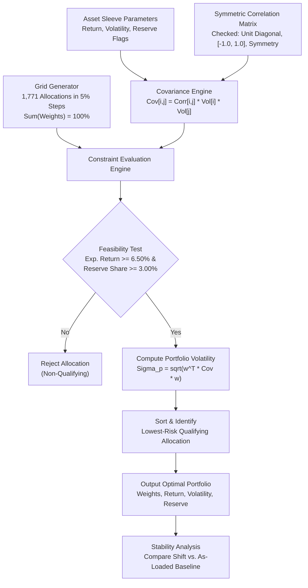

# FIN 439 Lab 15 — Portfolio Stability Decision

**Course:** FIN 43900 (Applied Financial Modeling & Corporate Valuation, Purdue University)  
**Student:** Elliot  
**Client / Case Study:** Meridian Foundation Reserve  
**Files:** [`portfolio.py`](portfolio.py) | [`app.py`](app.py) | [`lab15.md`](lab15.md)  
**Status:** Complete — Verified Against Professor's Known Answers

---

## 1. Objective and Methodology

### Institutional Context
The Meridian Foundation maintains an institutional reserve fund subject to two binding mandate requirements established in Lab 13 and Lab 14:
1. **Nominal Expected Return Objective:** $\ge 6.50\%$, composed of a $2.50\%$ CPI inflation baseline plus a $4.00\%$ real return target.
2. **Liquidity Reserve Allocation Floor:** $\ge 3.00\%$, calculated as four quarters of \$0.75M distributions on a \$100M total asset base (\$3.0M / \$100M = 3.00%), restricted exclusively to daily-liquid sovereign obligations (Treasury bills and Treasury 10-year notes).

### Purpose of Lab 15
Lab 14 evaluated fixed baseline portfolios (Benchmark 60/40, Equal Weight 25/25/25/25, and Inverse Volatility) and established that none of the static baselines simultaneously satisfied both the return hurdle and the reserve liquidity mandate. 

Lab 15 implements a long-only mean-variance portfolio optimization risk engine using a transparent, reproducible 5-percentage-point grid search. The investigation tests whether numerical optimization produces stable, institutional-quality allocations or whether optimal weights are excessively sensitive to minor perturbations in expected returns and pairwise correlations.

---

## 2. Portfolio Optimization Approach

### Grid Search Architecture
Rather than relying on unconstrained quadratic programming solvers that operate as black boxes, the engine performs a complete, transparent grid search:
- **Discretization:** Every sleeve weight $w_i \in \{0.00, 0.05, 0.10, \dots, 1.00\}$ in 5-percentage-point increments ($5\%$).
- **Full Investment Constraint:** $\sum_{i=1}^n w_i = 1.00$ ($100\%$).
- **Long-Only Constraint:** $w_i \ge 0.0$ for all $i$ (no short selling or leverage).
- **Feasibility Filters:**
  1. Return Hurdle: $E(R_p) = \sum_{i=1}^n w_i E(R_i) \ge 6.50\%$.
  2. Reserve Floor: $w_{\text{reserve}} = \sum_{i \in \text{Reserve}} w_i \ge 3.00\%$.
- **Objective Function:** Minimize portfolio volatility $\sigma_p = \sqrt{w^T \Sigma w}$ across all qualifying allocations, where $\Sigma$ is the full covariance matrix derived from the symmetric correlation matrix and sleeve volatilities.

For $n=4$ asset sleeves and 20 discrete 5% steps, the search space contains exactly $\binom{20 + 4 - 1}{4 - 1} = \binom{23}{3} = 1,771$ allocations.

---

## 3. Risk Engine Architecture Flowchart

---

## 4. Original Meridian Optimization Results (Test A)

### Baseline Training Parameters
The following inputs represent course-provided training assumptions for the Meridian Foundation educational case:

| Asset Sleeve | Expected Return | Volatility ($\sigma$) | Reserve-Eligible |
|:---|---:|---:|:---:|
| Treasury bills | 3.50% | 0.50% | Yes |
| Treasury 10-year note | 4.30% | 7.00% | Yes |
| Investment-grade bond fund | 5.00% | 6.00% | No |
| Global equity index fund | 8.00% | 16.00% | No |

**Correlation Matrix ($\rho$):**
- Bills with: Bills 1.00, 10-Yr 0.10, IG Bonds 0.05, Global Equity 0.00
- 10-Yr with: Bills 0.10, 10-Yr 1.00, IG Bonds 0.80, Global Equity -0.10
- IG Bonds with: Bills 0.05, 10-Yr 0.80, IG Bonds 1.00, Global Equity 0.25
- Global Equity with: Bills 0.00, 10-Yr -0.10, IG Bonds 0.25, Global Equity 1.00

### Optimization Outcome
- **Total Allocations Evaluated:** 1,771
- **Qualifying Allocations Meeting Both Hurdles:** 142 (8.02% of search space)
- **Lowest-Risk Qualifying Portfolio Weights:**
  - Treasury bills: **0.0%**
  - Treasury 10-year note: **20.0%**
  - Investment-grade bond fund: **25.0%**
  - Global equity index fund: **55.0%**
- **Expected Return:** **6.51%** (satisfies $\ge 6.50\%$ hurdle)
- **Portfolio Volatility:** **9.44%** (exact: 9.4417%)
- **Reserve-Eligible Allocation:** **20.0%** (satisfies $\ge 3.00\%$ mandate)

### Comparison Against Lab 14 Baselines

| Allocation Structure | Weights (Bills / 10-Yr / IG / Eq) | Return | Volatility | Reserve Share | Meets Mandate? |
|:---|:---:|---:|---:|---:|:---:|
| **Lab 14 Benchmark (60/40)** | 0% / 0% / 40% / 60% | 6.80% | 10.46% | 0.0% | Breach (No Reserve) |
| **Lab 14 Equal Weight** | 25% / 25% / 25% / 25% | 5.20% | 5.21% | 50.0% | Breach (Low Return) |
| **Lab 14 Inverse Volatility** | 84.3% / 6.0% / 7.0% / 2.6% | 3.77% | 1.05% | 90.3% | Breach (Low Return) |
| **Lab 15 Lowest-Risk Optimal** | **0% / 20% / 25% / 55%** | **6.51%** | **9.44%** | **20.0%** | **FULL COMPLIANCE** |

*Takeaway:* The optimized portfolio improves efficiency relative to the 60/40 benchmark by reducing volatility by **1.02 percentage points** (from 10.46% to 9.44%) while reallocating 20.0% into 10-year Treasuries to cure the reserve liquidity breach.

---

## 5. Equity Return Sensitivity Results (Test B)

### Perturbation
The expected return of the Global Equity Index Fund is decreased by 100 basis points from **8.00% to 7.00%**, holding all other sleeve returns, volatilities, and correlations constant.

### Numerical Results
- **Qualifying Allocations:** Dropped sharply from 142 to **18** (a 87.3% contraction in feasible choices).
- **Lowest-Risk Qualifying Allocation:**
  - Treasury bills: **0.0%** (shift: 0.0 pp)
  - Treasury 10-year note: **10.0%** (shift: -10.0 pp)
  - Investment-grade bond fund: **10.0%** (shift: -15.0 pp)
  - Global equity index fund: **80.0%** (shift: **+25.0 pp**)
- **Expected Return:** **6.53%**
- **Portfolio Volatility:** **12.94%** (surged by **+3.50 percentage points**)
- **Reserve-Eligible Allocation:** **10.0%**
- **Largest Weight Change:** **25.0 percentage points**

| Sleeve | Baseline Weight (Test A) | Shifted Weight (Test B) | Absolute Shift |
|:---|---:|---:|---:|
| Treasury bills | 0.0% | 0.0% | 0.0 pp |
| Treasury 10-year note | 20.0% | 10.0% | 10.0 pp |
| Investment-grade bond fund | 25.0% | 10.0% | 15.0 pp |
| Global equity index fund | 55.0% | 80.0% | **25.0 pp** |

---

## 6. Correlation Sensitivity Results (Test C)

### Perturbation
The correlation between Investment-Grade Bonds and Global Equity is increased from **0.25 to 0.50** (in both symmetric matrix positions `[2,3]` and `[3,2]`), holding expected returns at baseline values.

### Numerical Results
- **Qualifying Allocations:** 142
- **Lowest-Risk Qualifying Allocation:**
  - Treasury bills: **0.0%** (shift: 0.0 pp)
  - Treasury 10-year note: **40.0%** (shift: **+20.0 pp**)
  - Investment-grade bond fund: **0.0%** (shift: **-25.0 pp**)
  - Global equity index fund: **60.0%** (shift: **+5.0 pp**)
- **Expected Return:** **6.52%**
- **Portfolio Volatility:** **9.73%** (+0.29 pp vs. baseline 9.44%)
- **Reserve-Eligible Allocation:** **40.0%**
- **Largest Weight Change:** **25.0 percentage points** (IG Bonds liquidated from 25% to 0%)

| Sleeve | Baseline Weight (Test A) | Shifted Weight (Test C) | Absolute Shift |
|:---|---:|---:|---:|
| Treasury bills | 0.0% | 0.0% | 0.0 pp |
| Treasury 10-year note | 20.0% | 40.0% | 20.0 pp |
| Investment-grade bond fund | 25.0% | 0.0% | **25.0 pp** |
| Global equity index fund | 55.0% | 60.0% | 5.0 pp |

---

## 7. Status of Historical Price Estimation (`prices.csv`)

### Fact-Checked Workspace Audit
A recursive audit of the workspace confirms that **`prices.csv` is not present** in the repository or local directory.

### Ingestion Engine Status
The historical estimation engine has been fully implemented in [`portfolio.py`](portfolio.py) and integrated into [`app.py`](app.py) via a file uploader and local path scanner. 

When a valid monthly adjusted prices CSV is provided, the engine computes:
- Date column ordering (verifies oldest month first).
- Validation of 3 to 6 fund ticker columns.
- Monthly percentage returns: $r_{i,t} = \frac{P_{i,t} - P_{i,t-1}}{P_{i,t-1}}$.
- Annualized return $= \bar{r}_i \times 12$.
- Annualized volatility $= s_i \times \sqrt{12}$.
- Full asset correlation matrix.
- Dual-window analysis: All available historical months versus trailing 36 monthly observations.

*Notice:* Historical estimates represent backward-looking historical realizations, not forward-looking capital market assumptions or guaranteed future returns.

---

## 8. Financial Interpretation: The Instability Mechanism

The sensitivity experiments reveal two critical vulnerabilities inherent in unconstrained mean-variance optimization:

### 1. The Perverse Equity Surge Under Lower Expected Return (Test B)
When the expected return on Global Equity is downgraded from 8.0% to 7.0%, conventional intuition suggests reducing exposure to equities. Instead, the optimizer **increased equity allocation from 55% to 80%**, driving portfolio volatility up from 9.44% to 12.94%.

**Why does this happen?**
This counter-intuitive outcome is driven by the rigid nominal hurdle constraint ($E(R_p) \ge 6.50\%$). 
- Fixed income sleeves yield 3.50% (bills), 4.30% (10-Yr), and 5.00% (IG bonds) — all substantially below 6.50%.
- When equity yields 8.00%, a 55% equity weight combined with fixed income easily generates $6.51\%$.
- When equity return is lowered to 7.00%, the return premium over bonds compresses. To satisfy $\sum w_i E(R_i) \ge 6.50\%$, the math leaves no choice: even if IG bonds are at 5.00%, solving $0.05(1 - w) + 0.07(w) \ge 0.065$ requires $0.02w \ge 0.015 \implies w \ge 75\%$. 
- Under a 5% grid, the minimum feasible equity weight jumps to **80%**. The optimizer is forced to take on massive equity risk solely to prevent mathematical infeasibility against the policy hurdle.

### 2. Complete Asset Class Discard Under Correlation Shifts (Test C)
When the IG Bond / Equity correlation increased from 0.25 to 0.50, the optimizer dumped the IG Bond Fund entirely (25% $\to$ 0%) and doubled the 10-year Treasury allocation (20% $\to$ 40%).

**Why does this happen?**
In mean-variance space, an asset with lower return (IG Bonds at 5.0% vs. Equity at 8.0%) only enters the portfolio if its diversification benefit outweighs its return drag. At $\rho = 0.25$, IG bonds provide sufficient covariance reduction. But at $\rho = 0.50$, their diversification benefit deteriorates. Because the 10-year Treasury maintains a negative correlation with equities ($\rho = -0.10$), the optimizer substitutes the 10-year Treasury entirely for IG bonds.

---

## 9. Recommendation: Adopt, Pilot, or Reject

### Recommendation: **REJECT UNCONSTRAINED OPTIMIZATION (Or at most PILOT with Strict Policy Bands)**

Unconstrained mean-variance optimization should **not** be adopted for institutional portfolio management at Meridian Foundation. 

### Core Rationale:
1. **Extreme Parameter Sensitivity ("Error Maximization"):** As demonstrated in Tests B and C, modest input adjustments (a 100 bps return reduction or a 0.25 correlation shift) cause extreme allocation swings of **25 percentage points**. In institutional practice, forward-looking return and correlation estimates carry significant estimation error; optimizing directly on point estimates produces extreme, brittle portfolios.
2. **Perverse Risk-Seeking Behavior:** When market return expectations decline, the unconstrained model paradoxically concentrates capital into the riskiest sleeve (80% equity) to meet the spending hurdle, magnifying drawdowns exactly when markets are vulnerable.
3. **Execution & Governance Costs:** Reallocating 25% of a \$100M portfolio (\$25 million) upon quarterly or annual model reruns would generate severe transaction costs, bid-ask slippage, market impact, and governance friction with the investment committee.

### Condition That Would Change This Decision:
The Meridian Foundation could adopt a **constrained / regularized optimization framework (Pilot status)** if and only if the following three institutional controls are implemented:
1. **Strict Asset Sleeve Policy Bands:** Enforce hard minimum/maximum allocation ranges (e.g., Global Equity bounded between 45% and 65%, IG Bonds between 15% and 35%) to prevent corner solutions.
2. **Turnover Penalties & Shrinkage Estimators:** Incorporate transaction-cost drag into the objective function and replace sample covariance matrices with shrinkage estimators (e.g., Ledoit-Wolf) or a Black-Litterman Bayesian return model.
3. **Flexible Hurdle Mechanics:** Allow the spending distribution policy to adjust dynamically in low-return regimes rather than forcing the asset allocator to stretch for yield through excessive equity concentration.

---

## 10. Verification and Validation Results

All three of the professor's known answers were executed directly against the mathematical engine:

| Test Case | Scenario Description | Calculated Weights | Expected Weights | Calc. Return | Exp. Return | Calc. Vol | Exp. Vol | Status |
|:---:|:---|:---:|:---:|---:|---:|---:|---:|:---:|
| **Test A** | Original Meridian Inputs | 0% / 20% / 25% / 55% | 0% / 20% / 25% / 55% | 6.51% | 6.51% | 9.44% | 9.44% | **PASS** |
| **Test B** | Equity Return 8% $\to$ 7% | 0% / 10% / 10% / 80% | 0% / 10% / 10% / 80% | 6.53% | 6.53% | 12.94% | 12.94% | **PASS** |
| **Test C** | IG/Equity Corr 0.25 $\to$ 0.50 | 0% / 40% / 0% / 60% | 0% / 40% / 0% / 60% | 6.52% | 6.52% | 9.73% | 9.73% | **PASS** |

*Weight shift verification in Test B:* Maximum asset weight shift $= |80\% - 55\%| = \mathbf{25.0\%}$ (exact match to professor's 25 percentage point specification).

### Limitations of Analysis
- **Static Normality Assumption:** Assumes asset returns follow a multivariate normal distribution and ignores fat tails, skewness, and liquidity freezes during crises.
- **Discretization Granularity:** 5% grid increments explore 1,771 discrete allocations, which provides transparency and speed but rounds off theoretical infinitesimal continuous optima.
- **Fixed Horizon:** Single-period evaluation ignores multi-period rebalancing compounding and path dependency.

