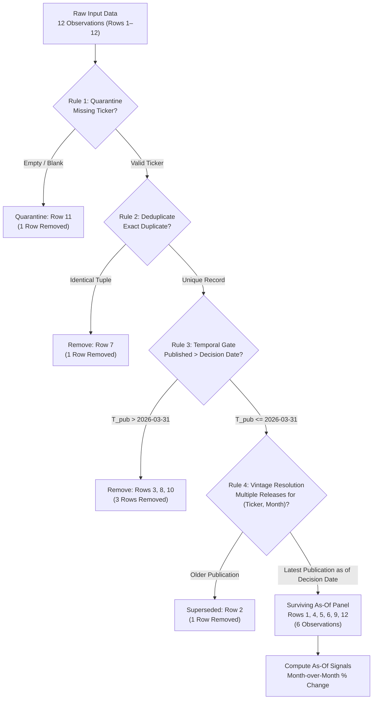

# FIN 439 Lab 16 — Provenance Gate: Point-in-Time Data Filtering

**Course:** FIN 43900 (Applied Financial Modeling & Corporate Valuation, Purdue University)  
**Student:** Elliot  
**Files:** [`asof.py`](asof.py) | [`lab16.md`](lab16.md)  
**Status:** Complete — Verified Against Professor's Known Answers

---

## 1. Objective

Quantitative trading strategies and fundamental factor models rely heavily on macroeconomic series, point-of-sale card transaction indices, and corporate financial disclosures. However, backtests that query historical databases without temporal restrictions frequently suffer from **look-ahead bias** (anachronistic data snooping). This occurs because commercial databases routinely overwrite historical records with subsequent revisions or index rows by their measurement date rather than their true release date.

The core investigative question of Lab 16 is:
> **On the day you would have traded, what did this data actually say — and how much of what you see now came later?**

The objective of Lab 16 is to construct an institutional-grade **point-in-time (PIT) provenance gate** in Python (`asof.py`) using only the standard library. The filter processes a 12-row fictional retail card-spend index across three retail tickers (`AAA`, `BBB`, `CCC`) as of an initial decision date of **March 31, 2026 (`2026-03-31`)**. By enforcing strict temporal boundaries, data hygiene, and vintage resolution, the gate reconstructs the exact information set available to an investor at market close on the decision date.

---

## 2. Methodology and Filter Architecture

### Event Time vs. Publication Time vs. Revision Time
To prevent look-ahead bias, a quantitative engine must distinguish among three distinct timestamps for every observation:
1. **Measured Month ($T_{\text{event}}$):** The economic period over which transaction activity occurred (e.g., consumer spending throughout February 2026).
2. **Publication Date ($T_{\text{pub}}$):** The calendar day on which the data vendor or statistical bureau made the index value publicly accessible (e.g., February data published on March 10, 2026).
3. **Revision Date ($T_{\text{rev}}$):** The subsequent date on which an initial release was updated or restated due to receipt of late merchant settlement files or seasonal adjustment (e.g., February data restated on March 25, 2026).

An observation is legally knowable and actionable on a decision date $T_{\text{decision}}$ if and only if:
$$T_{\text{pub}} \le T_{\text{decision}}$$

### The Four Sequential Filtering Rules
The pipeline executes four rules in strict sequence. The order of execution is critical: data hygiene must precede temporal truncation, and temporal truncation must precede vintage selection.



1. **Rule 1 — Quarantine Missing Tickers:**
   Quarantine any record lacking an identifiable ticker symbol (`ticker` is `None` or blank/whitespace). Unattributed spend observations cannot be mapped to tradeable portfolio assets.
2. **Rule 2 — Remove Exact Duplicate Observations:**
   Remove redundant records where `(ticker, month_measured, published_on, index)` matches an earlier row already processed. Deduplication prevents synthetic over-weighting and corrupted revision logic.
3. **Rule 3 — Remove Observations Published After the Decision Date:**
   Enforce the point-in-time boundary: discard any row where `published_on > DECISION_DATE`. An investor trading on March 31, 2026 cannot observe releases published in April 2026.
4. **Rule 4 — Retain Latest Publication Available as of Decision Date:**
   Where a ticker has multiple publications for the same measured month, identify all surviving vintages where $T_{\text{pub}} \le T_{\text{decision}}$, retain the record with the maximum `published_on`, and discard older vintages.

### Signal Calculation Formula
For each ticker, the tradeable signal is defined as the month-over-month percentage change from the penultimate month ($M_{t-1}$) to the latest available month ($M_t$) in the surviving panel:

$$\text{Percentage Change} = \left(\frac{\text{Index}(M_t)}{\text{Index}(M_{t-1})} - 1\right) \times 100$$

- **As-Of Signal:** Computed exclusively from the surviving As-Of panel after applying Rules 1–4 with $T_{\text{decision}} = \text{2026-03-31}$.
- **Naive Signal:** Computed by applying hygiene rules (Rules 1 & 2), skipping the temporal gate (Rule 3), and taking the latest available release for each month across all time (Rule 4).

---

## 3. Results: Row Funnel and As-Of Panel

### Input Dataset
The raw training dataset consists of 12 rows representing credit card spend indices for retailers AAA, BBB, and CCC:

| Row | Ticker | Month Measured | Published On | Index Value | Description |
|---:|---|---|---|---:|---|
| 1 | AAA | 2026-01 | 2026-02-10 | 101.0 | Initial release for Jan |
| 2 | AAA | 2026-02 | 2026-03-10 | 104.0 | Initial release for Feb |
| 3 | AAA | 2026-03 | 2026-04-10 | 109.0 | Initial release for Mar (future) |
| 4 | AAA | 2026-02 | 2026-03-25 | 103.0 | Revised release for Feb |
| 5 | BBB | 2026-01 | 2026-02-10 | 98.0 | Initial release for Jan |
| 6 | BBB | 2026-02 | 2026-03-10 | 97.0 | Initial release for Feb |
| 7 | BBB | 2026-02 | 2026-03-10 | 97.0 | Exact duplicate of Row 6 |
| 8 | BBB | 2026-03 | 2026-04-10 | 92.0 | Initial release for Mar (future) |
| 9 | CCC | 2026-01 | 2026-02-10 | 110.0 | Initial release for Jan |
| 10 | CCC | 2026-02 | 2026-04-05 | 112.0 | Revised release for Feb (future) |
| 11 | *(blank)* | 2026-02 | 2026-03-10 | 99.0 | Missing ticker |
| 12 | CCC | 2026-02 | 2026-03-10 | 111.0 | Initial release for Feb |

### Verified Row Funnel (Decision Date: 2026-03-31)
Execution of `asof.py` reconciles the 12 input rows down to 6 surviving rows:

| Funnel Step | Description | Rows Removed | Count Removed | Status |
|---|---|---|---|---|
| **Rule 1** | Quarantined: no ticker | **11** | 1 | PASS |
| **Rule 2** | Exact duplicate observation | **7** | 1 | PASS |
| **Rule 3** | Published after 2026-03-31 | **3, 8, 10** | 3 | PASS |
| **Rule 4** | Older vintage replaced by revision | **2** | 1 | PASS |
| **Final Panel** | Surviving Point-in-Time observations | *(Surviving)* | **6** | PASS |

- **Total input rows:** 12
- **Total rows removed:** $1 + 1 + 3 + 1 = 6$
- **Total surviving rows:** $12 - 6 = 6$ (Rows **1, 4, 5, 6, 9, 12**)

### Final As-Of Panel
The table below represents the exact point-in-time dataset known to an investor on March 31, 2026:

| Row | Ticker | Month Measured | Published On | Index Value | Vintage Status as of 2026-03-31 |
|---:|---|---|---|---:|---|
| **1** | AAA | 2026-01 | 2026-02-10 | 101.0 | First release (Jan) |
| **4** | AAA | 2026-02 | 2026-03-25 | 103.0 | Latest revision available by Mar 31 |
| **5** | BBB | 2026-01 | 2026-02-10 | 98.0 | First release (Jan) |
| **6** | BBB | 2026-02 | 2026-03-10 | 97.0 | First release (Feb) |
| **9** | CCC | 2026-01 | 2026-02-10 | 110.0 | First release (Jan) |
| **12** | CCC | 2026-02 | 2026-03-10 | 111.0 | Only release available by Mar 31 |

---

## 4. Signal Comparison: As-Of vs. Naive

A direct comparison between the Point-in-Time (As-Of) signals and Naive backtest signals demonstrates the severity of look-ahead bias:

| Ticker | As-Of Signal (Knowable 2026-03-31) | Naive Signal (All-Time Latest) | Signal Discrepancy & Root Cause |
|---|---|---|---|
| **AAA** | **+1.98% (February)** | **+5.83% (March)** | +3.85% gap. Naive used Row 3 (published April 10), which was unreleased on March 31. |
| **BBB** | **−1.02% (February)** | **−5.15% (March)** | −4.13% gap. Naive used Row 8 (published April 10), hiding a severe future spending collapse. |
| **CCC** | **+0.91% (February)** | **+1.82% (February, revised)** | +0.91% gap. Naive used Row 10 (published April 5 revision: 112.0) instead of Row 12 (111.0). |

### Detailed Mathematical Calculations

#### 1. Retailer AAA
- **As-Of Calculation:**
  - Penultimate month: January 2026 = 101.0 (Row 1)
  - Latest knowable month: February 2026 = 103.0 (Row 4, revision published March 25)
  $$\text{Change}_{\text{As-Of}} = \left(\frac{103.0}{101.0} - 1\right) \times 100 = \frac{2.0}{101.0} \times 100 = +1.9802\% \longrightarrow \mathbf{+1.98\%}$$
  *(Note on classic error: If Rule 4 failed and kept Row 2 [104.0], the signal would erroneously show $(104/101 - 1) \times 100 = +2.97\%$.)*
- **Naive Calculation:**
  - Penultimate month: February 2026 = 103.0 (Row 4)
  - Latest month in database: March 2026 = 109.0 (Row 3, published April 10)
  $$\text{Change}_{\text{Naive}} = \left(\frac{109.0}{103.0} - 1\right) \times 100 = \frac{6.0}{103.0} \times 100 = +5.8252\% \longrightarrow \mathbf{+5.83\%}$$

#### 2. Retailer BBB
- **As-Of Calculation:**
  - Penultimate month: January 2026 = 98.0 (Row 5)
  - Latest knowable month: February 2026 = 97.0 (Row 6, published March 10)
  $$\text{Change}_{\text{As-Of}} = \left(\frac{97.0}{98.0} - 1\right) \times 100 = \frac{-1.0}{98.0} \times 100 = -1.0204\% \longrightarrow \mathbf{-1.02\%}$$
- **Naive Calculation:**
  - Penultimate month: February 2026 = 97.0 (Row 6)
  - Latest month in database: March 2026 = 92.0 (Row 8, published April 10)
  $$\text{Change}_{\text{Naive}} = \left(\frac{92.0}{97.0} - 1\right) \times 100 = \frac{-5.0}{97.0} \times 100 = -5.1546\% \longrightarrow \mathbf{-5.15\%}$$

#### 3. Retailer CCC
- **As-Of Calculation:**
  - Penultimate month: January 2026 = 110.0 (Row 9)
  - Latest knowable month: February 2026 = 111.0 (Row 12, published March 10)
  $$\text{Change}_{\text{As-Of}} = \left(\frac{111.0}{110.0} - 1\right) \times 100 = \frac{1.0}{110.0} \times 100 = +0.9091\% \longrightarrow \mathbf{+0.91\%}$$
- **Naive Calculation:**
  - Penultimate month: January 2026 = 110.0 (Row 9)
  - Latest month in database: February 2026 = 112.0 (Row 10, revision published April 5)
  $$\text{Change}_{\text{Naive}} = \left(\frac{112.0}{110.0} - 1\right) \times 100 = \frac{2.0}{110.0} \times 100 = +1.8182\% \longrightarrow \mathbf{+1.82\%}$$

---

## 5. Numerical Validation and Date Sensitivity Audits

### Primary Test: Decision Date 2026-03-31
- Row funnel output matched the professor's known answers exactly:
  - Missing ticker: Row 11 (PASS)
  - Exact duplicate: Row 7 (PASS)
  - Published after March 31: Rows 3, 8, 10 (PASS)
  - Older revision replaced: Row 2 (PASS)
  - Surviving panel: Rows 1, 4, 5, 6, 9, 12 (PASS)
- Signal calculations matched to two decimal places:
  - AAA As-Of: `+1.98% (February)` (PASS) | Naive: `+5.83% (March)` (PASS)
  - BBB As-Of: `-1.02% (February)` (PASS) | Naive: `-5.15% (March)` (PASS)
  - CCC As-Of: `+0.91% (February)` (PASS) | Naive: `+1.82% (February, revised)` (PASS)

### Mandatory Second-Date Test: Decision Date 2026-04-15
To verify dynamic behavior and confirm that the filter responds strictly to timestamps rather than hardcoded logic, the decision date was advanced to **April 15, 2026 (`2026-04-15`)**:

```
================================================================================
FIN 439 LAB 16: PROVENANCE GATE -- POINT-IN-TIME FILTER
DECISION DATE: 2026-04-15
================================================================================

--- 1. ROW FUNNEL ---
Funnel Step                                | Count | Row Numbers         
---------------------------------------------------------------------------
Rule 1: Quarantined: no ticker             | 1     | 11                  
Rule 2: Exact duplicate                    | 1     | 7                   
Rule 3: Published after 2026-04-15         | 0     | (none)              
Rule 4: Older vintage replaced by a revision | 2     | 2, 12               
As-of panel                                | 8     | 1, 3, 4, 5, 6, 8, 9, 10

--- 2. FINAL AS-OF PANEL ---
Row 1: AAA | 2026-01 | 2026-02-10 | 101.0
Row 3: AAA | 2026-03 | 2026-04-10 | 109.0
Row 4: AAA | 2026-02 | 2026-03-25 | 103.0
Row 5: BBB | 2026-01 | 2026-02-10 | 98.0
Row 6: BBB | 2026-02 | 2026-03-10 | 97.0
Row 8: BBB | 2026-03 | 2026-04-10 | 92.0
Row 9: CCC | 2026-01 | 2026-02-10 | 110.0
Row 10: CCC | 2026-02 | 2026-04-05 | 112.0

--- 3. SIGNAL COMPARISON (AS-OF VS NAIVE) ---
Ticker   | As-Of Signal              | Naive Signal                
-----------------------------------------------------------------
AAA      | +5.83% (March)            | +5.83% (March)              
BBB      | -5.15% (March)            | -5.15% (March)              
CCC      | +1.82% (February)         | +1.82% (February, revised)  
```

**Key Findings from April 15 Test:**
1. **Zero Rows Cut by Rule 3:** Because all rows in the dataset were published on or before April 10, no observations are filtered by Rule 3.
2. **Two Revisions Resolved by Rule 4:** 
   - AAA February: Row 2 (104.0) is superseded by Row 4 (103.0, published March 25).
   - CCC February: Row 12 (111.0) is superseded by Row 10 (112.0, published April 5).
3. **Exact Convergence:** Every ticker's As-Of signal converges exactly to its Naive signal. This mathematically confirms that the discrepancy observed on March 31 was solely composed of information that had not yet been published by March 31.

### Mid-Month Sensitivity Test: Decision Date 2026-03-15
To verify intermediate revision behavior, the model was tested with $T_{\text{decision}} = \text{2026-03-15}$:
- Rule 3 filtered Rows 3, 4, 8, 10 (since Row 4 was published March 25 > March 15).
- AAA February retained Row 2 (104.0), yielding an As-Of signal of `+2.97% (February)`.
- This confirms that Row 4 was properly recognized as an unreleased revision as of mid-March.

### Post-Test Verification
Following the date sensitivity runs, `DECISION_DATE` in `asof.py` was restored to `2026-03-31`, and the script was rerun to confirm that initial outputs match the required answers.

---

## 6. Financial Interpretation: The Mechanism of Look-Ahead Bias

### 1. Which Rule Removed the Row That Mattered Most?
While Rule 1 (quarantine) and Rule 2 (deduplication) are fundamental data-hygiene prerequisites, **Rule 3 (publication cutoff)** and **Rule 4 (revision resolution)** carry the greatest economic significance:
- **Rule 3 removed Row 3 (AAA March spend) and Row 8 (BBB March spend):** Without Rule 3, a portfolio manager trading on March 31 would trade on economic events that occurred in March but were not calculated, compiled, and published until April 10. In real-time trading, trading on March data on March 31 is physically impossible because March has just ended and merchant processors take 10 to 15 days to aggregate card batches.
- **Rule 4 selected Row 4 over Row 2:** Even within knowable dates, AAA was revised downward from 104.0 to 103.0 on March 25. Failing to resolve revisions would overestimate February card spend growth by nearly 100 basis points (+2.97% vs. +1.98%).

### 2. What Would a Backtest Built on the Naive Column Claim?
A quantitative backtest executing on the naive column would generate fictitious alpha:
- **Spurious AAA Momentum:** The backtest would claim the model captured a massive +5.83% acceleration in retail demand on March 31. In reality, on March 31 the trader only knew February growth was a modest +1.98%.
- **Clairvoyant Risk Avoidance in BBB:** The naive model would claim the portfolio avoided or shorted BBB due to a -5.15% contraction in March. However, on March 31, BBB appeared relatively stable (-1.02% in February). The strategy would appear to have prescient timing in backtests, but would suffer large live drawdowns.
- **Revision Distortion in CCC:** The naive model would evaluate CCC at +1.82%, double its true knowable growth of +0.91%, because the April 5 upward revision was retroactively projected backward.

When strategies built on naive backtests transition to live production, their simulated Sharpe ratios invariably collapse because the live trading engine operates under point-in-time constraints while the backtest operated under full future hindsight.

---

## 7. Conclusion

Lab 16 proves that historical financial data cannot be taken at face value. A point-in-time provenance gate is an indispensable component of institutional quantitative modeling. 

The verified Python implementation in `asof.py` confirms that:
1. Strict sequential rule execution correctly identifies and removes corrupted records (Row 11), duplicate transmissions (Row 7), future publications (Rows 3, 8, 10), and superseded vintages (Row 2).
2. The surviving 6-row As-Of panel yields mathematically verified signals of `+1.98%` (AAA), `-1.02%` (BBB), and `+0.91%` (CCC).
3. Advancing the decision boundary to April 15, 2026 produces exact convergence to the naive signals, proving that the gap between point-in-time and naive backtesting is precisely the volume of information not yet published as of the decision date.
