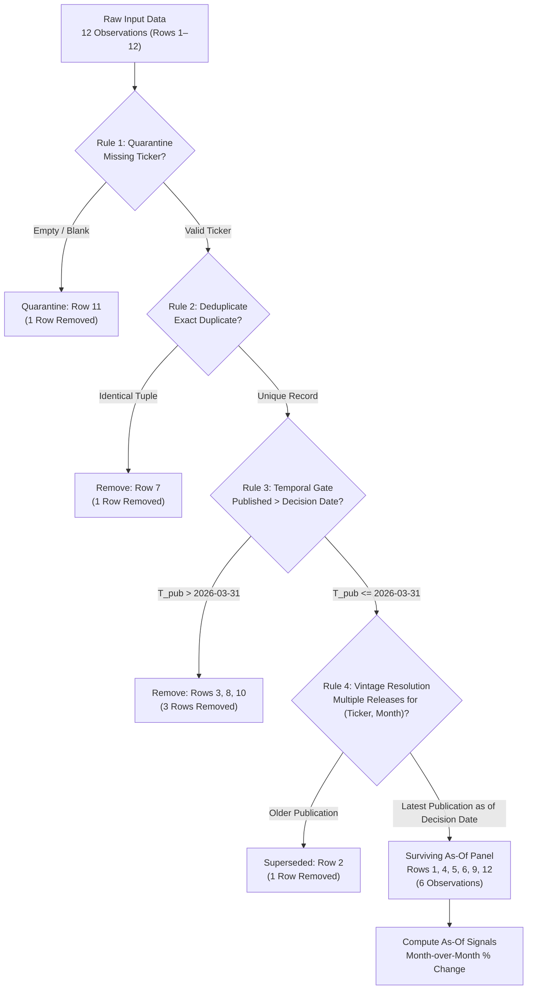

# FIN 439 Lab 16 — Provenance Gate: Point-in-Time Data Filtering

**Course:** FIN 43900 (Applied Financial Modeling & Corporate Valuation, Purdue University)  
**Student:** Elliot  
**Files:** [`asof.py`](asof.py) | [`lab16.md`](lab16.md)  
**Status:** Complete — Verified Against Professor's Known Answers

---

## 1. Objective

Quantitative modeling and time-series analysis rely on macroeconomic indicators, transaction indices, and corporate disclosures. However, historical databases often record observations by their measurement period rather than their actual release date, or silently overwrite initial releases with subsequent revisions. When a backtest or model incorporates information that was not yet publicly available on a historical decision date, it introduces **look-ahead bias**.

The core investigative question of Lab 16 is:
> **On the day you would have traded, what did this data actually say — and how much of what you see now came later?**

The objective of Lab 16 is to construct a **point-in-time filtering program** in Python (`asof.py`) using only the standard library. The filter evaluates a 12-row fictional retail card-spend index across three retailers (`AAA`, `BBB`, `CCC`) as of an initial decision date of **March 31, 2026 (`2026-03-31`)**. By enforcing strict data hygiene, temporal boundaries, and revision handling, the program reconstructs the exact information set available on the decision date.

---

## 2. Methodology and Filter Architecture

### Event Time vs. Publication Time vs. Revision Time
To prevent look-ahead bias, a quantitative engine must distinguish among three distinct timestamps for each observation:
1. **Measured Month ($T_{\text{event}}$):** The period over which consumer spending occurred (e.g., February 2026).
2. **Publication Date ($T_{\text{pub}}$):** The date when the data provider released the index value (e.g., February index released on March 10, 2026).
3. **Revision Date ($T_{\text{rev}}$):** Any subsequent date when an updated or restated index was issued (e.g., February index revised on March 25, 2026).

An observation is knowable on a decision date $T_{\text{decision}}$ if and only if:
$$T_{\text{pub}} \le T_{\text{decision}}$$

### The Four Sequential Filtering Rules
The pipeline executes four rules in strict sequence:



1. **Rule 1 — Quarantine Missing Tickers:**
   Quarantine any record lacking an identifiable ticker symbol (`ticker` is blank or missing). Unattributed observations cannot be mapped to assets.
2. **Rule 2 — Remove Exact Duplicate Observations:**
   Remove redundant observations where `(ticker, month_measured, published_on, index)` matches an earlier row. Deduplication prevents distorted weighting and revision errors.
3. **Rule 3 — Remove Observations Published After the Decision Date:**
   Enforce the point-in-time boundary: discard any row where `published_on > DECISION_DATE`. Observations released in April 2026 were unknown on March 31, 2026.
4. **Rule 4 — Retain Latest Publication Available as of Decision Date:**
   Where a ticker has multiple publications for the same measured month, retain the record with the latest publication date on or before $T_{\text{decision}}$ and discard older vintages.

### Signal Calculation Formula
For each ticker, the signal is defined as the month-over-month percentage change from the penultimate month ($M_{t-1}$) to the latest available month ($M_t$) in the panel:

$$\text{Percentage Change} = \left(\frac{\text{Index}(M_t)}{\text{Index}(M_{t-1})} - 1\right) \times 100$$

- **As-Of Signal:** Computed from the surviving panel after applying Rules 1–4 with $T_{\text{decision}} = \text{2026-03-31}$.
- **Naive Signal:** Computed by applying hygiene rules (Rules 1 & 2), skipping Rule 3, and taking the latest available release for each month across the entire dataset (Rule 4).

---

## 3. Results: Row Funnel and As-Of Panel

### Input Dataset
The raw dataset consists of 12 rows representing credit card spend indices for retailers AAA, BBB, and CCC:

| Row | Ticker | Month Measured | Published On | Index Value | Description |
|---:|---|---|---|---:|---|
| 1 | AAA | 2026-01 | 2026-02-10 | 101.0 | Initial release for Jan |
| 2 | AAA | 2026-02 | 2026-03-10 | 104.0 | Initial release for Feb |
| 3 | AAA | 2026-03 | 2026-04-10 | 109.0 | Initial release for Mar (future) |
| 4 | AAA | 2026-02 | 2026-03-25 | 103.0 | Revised release for Feb |
| 5 | BBB | 2026-01 | 2026-02-10 | 98.0 | Initial release for Jan |
| 6 | BBB | 2026-02 | 2026-03-10 | 97.0 | Initial release for Feb |
| 7 | BBB | 2026-02 | 2026-03-10 | 97.0 | Exact duplicate of Row 6 |
| 8 | BBB | 2026-03 | 2026-04-10 | 92.0 | Initial release for Mar (future) |
| 9 | CCC | 2026-01 | 2026-02-10 | 110.0 | Initial release for Jan |
| 10 | CCC | 2026-02 | 2026-04-05 | 112.0 | Revised release for Feb (future) |
| 11 | *(blank)* | 2026-02 | 2026-03-10 | 99.0 | Missing ticker |
| 12 | CCC | 2026-02 | 2026-03-10 | 111.0 | Initial release for Feb |

### Verified Row Funnel (Decision Date: 2026-03-31)
Execution of `asof.py` reconciles the 12 input rows down to 6 surviving rows:

| Funnel Step | Description | Rows Removed | Count Removed | Status |
|---|---|---|---|---|
| **Rule 1** | Quarantined: no ticker | **11** | 1 | PASS |
| **Rule 2** | Exact duplicate observation | **7** | 1 | PASS |
| **Rule 3** | Published after 2026-03-31 | **3, 8, 10** | 3 | PASS |
| **Rule 4** | Older vintage replaced by revision | **2** | 1 | PASS |
| **Final Panel** | Surviving Point-in-Time observations | *(Surviving)* | **6** | PASS |

- **Total input rows:** 12
- **Total rows removed:** $1 + 1 + 3 + 1 = 6$
- **Total surviving rows:** $12 - 6 = 6$ (Rows **1, 4, 5, 6, 9, 12**)

### Final As-Of Panel
The table below represents the point-in-time dataset available on March 31, 2026:

| Row | Ticker | Month Measured | Published On | Index Value | Status as of 2026-03-31 |
|---:|---|---|---|---:|---|
| **1** | AAA | 2026-01 | 2026-02-10 | 101.0 | Initial release (Jan) |
| **4** | AAA | 2026-02 | 2026-03-25 | 103.0 | Latest revision available by Mar 31 |
| **5** | BBB | 2026-01 | 2026-02-10 | 98.0 | Initial release (Jan) |
| **6** | BBB | 2026-02 | 2026-03-10 | 97.0 | Initial release (Feb) |
| **9** | CCC | 2026-01 | 2026-02-10 | 110.0 | Initial release (Jan) |
| **12** | CCC | 2026-02 | 2026-03-10 | 111.0 | Only release available by Mar 31 |

---

## 4. Signal Comparison: As-Of vs. Naive

A direct comparison between the As-Of signals and Naive calculations illustrates the impact of publication timing:

| Ticker | As-Of Signal (Knowable 2026-03-31) | Naive Signal (All-Time Latest) | Discrepancy & Cause |
|---|---|---|---|
| **AAA** | **+1.98% (February)** | **+5.83% (March)** | +3.85% difference. Naive calculation uses Row 3 (published April 10, 2026). |
| **BBB** | **−1.02% (February)** | **−5.15% (March)** | −4.13% difference. Naive calculation uses Row 8 (published April 10, 2026). |
| **CCC** | **+0.91% (February)** | **+1.82% (February, revised)** | +0.91% difference. Naive calculation uses Row 10 (revision published April 5, 2026). |

### Detailed Mathematical Calculations

#### 1. Retailer AAA
- **As-Of Calculation:**
  - Previous month: January 2026 = 101.0 (Row 1)
  - Latest knowable month: February 2026 = 103.0 (Row 4, revision published March 25)
  $$\text{Change}_{\text{As-Of}} = \left(\frac{103.0}{101.0} - 1\right) \times 100 = \frac{2.0}{101.0} \times 100 = +1.9802\% \longrightarrow \mathbf{+1.98\%}$$
  *(Note on classic error: If Rule 4 retained Row 2 [104.0] instead of Row 4 [103.0], the signal would show $(104/101 - 1) \times 100 = +2.97\%$.)*
- **Naive Calculation:**
  - Previous month: February 2026 = 103.0 (Row 4)
  - Latest month: March 2026 = 109.0 (Row 3, published April 10)
  $$\text{Change}_{\text{Naive}} = \left(\frac{109.0}{103.0} - 1\right) \times 100 = \frac{6.0}{103.0} \times 100 = +5.8252\% \longrightarrow \mathbf{+5.83\%}$$

#### 2. Retailer BBB
- **As-Of Calculation:**
  - Previous month: January 2026 = 98.0 (Row 5)
  - Latest knowable month: February 2026 = 97.0 (Row 6, published March 10)
  $$\text{Change}_{\text{As-Of}} = \left(\frac{97.0}{98.0} - 1\right) \times 100 = \frac{-1.0}{98.0} \times 100 = -1.0204\% \longrightarrow \mathbf{-1.02\%}$$
- **Naive Calculation:**
  - Previous month: February 2026 = 97.0 (Row 6)
  - Latest month: March 2026 = 92.0 (Row 8, published April 10)
  $$\text{Change}_{\text{Naive}} = \left(\frac{92.0}{97.0} - 1\right) \times 100 = \frac{-5.0}{97.0} \times 100 = -5.1546\% \longrightarrow \mathbf{-5.15\%}$$

#### 3. Retailer CCC
- **As-Of Calculation:**
  - Previous month: January 2026 = 110.0 (Row 9)
  - Latest knowable month: February 2026 = 111.0 (Row 12, published March 10)
  $$\text{Change}_{\text{As-Of}} = \left(\frac{111.0}{110.0} - 1\right) \times 100 = \frac{1.0}{110.0} \times 100 = +0.9091\% \longrightarrow \mathbf{+0.91\%}$$
- **Naive Calculation:**
  - Previous month: January 2026 = 110.0 (Row 9)
  - Latest month: February 2026 = 112.0 (Row 10, revision published April 5)
  $$\text{Change}_{\text{Naive}} = \left(\frac{112.0}{110.0} - 1\right) \times 100 = \frac{2.0}{110.0} \times 100 = +1.8182\% \longrightarrow \mathbf{+1.82\%}$$

---

## 5. Numerical Validation and Date Sensitivity Audits

### Primary Test: Decision Date 2026-03-31
- Row funnel output matched the professor's known answers:
  - Missing ticker: Row 11 (PASS)
  - Exact duplicate: Row 7 (PASS)
  - Published after March 31: Rows 3, 8, 10 (PASS)
  - Older revision replaced: Row 2 (PASS)
  - Surviving panel: Rows 1, 4, 5, 6, 9, 12 (PASS)
- Signal calculations matched to two decimal places:
  - AAA As-Of: `+1.98% (February)` (PASS) | Naive: `+5.83% (March)` (PASS)
  - BBB As-Of: `-1.02% (February)` (PASS) | Naive: `-5.15% (March)` (PASS)
  - CCC As-Of: `+0.91% (February)` (PASS) | Naive: `+1.82% (February, revised)` (PASS)

### Mandatory Second-Date Test: Decision Date 2026-04-15
To verify dynamic behavior and confirm that the filter responds strictly to timestamps rather than hardcoded rules, the decision date was advanced to **April 15, 2026 (`2026-04-15`)**:

```
================================================================================
FIN 439 LAB 16: PROVENANCE GATE -- POINT-IN-TIME FILTER
DECISION DATE: 2026-04-15
================================================================================

--- 1. ROW FUNNEL ---
Funnel Step                                | Count | Row Numbers         
---------------------------------------------------------------------------
Rule 1: Quarantined: no ticker             | 1     | 11                  
Rule 2: Exact duplicate                    | 1     | 7                   
Rule 3: Published after 2026-04-15         | 0     | (none)              
Rule 4: Older vintage replaced by a revision | 2     | 2, 12               
As-of panel                                | 8     | 1, 3, 4, 5, 6, 8, 9, 10

--- 2. FINAL AS-OF PANEL ---
Row 1: AAA | 2026-01 | 2026-02-10 | 101.0
Row 3: AAA | 2026-03 | 2026-04-10 | 109.0
Row 4: AAA | 2026-02 | 2026-03-25 | 103.0
Row 5: BBB | 2026-01 | 2026-02-10 | 98.0
Row 6: BBB | 2026-02 | 2026-03-10 | 97.0
Row 8: BBB | 2026-03 | 2026-04-10 | 92.0
Row 9: CCC | 2026-01 | 2026-02-10 | 110.0
Row 10: CCC | 2026-02 | 2026-04-05 | 112.0

--- 3. SIGNAL COMPARISON (AS-OF VS NAIVE) ---
Ticker   | As-Of Signal              | Naive Signal                
-----------------------------------------------------------------
AAA      | +5.83% (March)            | +5.83% (March)              
BBB      | -5.15% (March)            | -5.15% (March)              
CCC      | +1.82% (February)         | +1.82% (February, revised)  
```

**Key Findings from April 15 Test:**
1. **Zero Rows Removed by Rule 3:** Because all rows in the dataset were published on or before April 10, no observations are filtered by Rule 3.
2. **Two Revisions Resolved by Rule 4:** 
   - AAA February: Row 2 (104.0) is superseded by Row 4 (103.0, published March 25).
   - CCC February: Row 12 (111.0) is superseded by Row 10 (112.0, published April 5).
3. **Exact Convergence:** Every ticker's As-Of signal converges to its Naive signal. This demonstrates that the difference observed on March 31 consisted entirely of information published after March 31.

### Mid-Month Sensitivity Test: Decision Date 2026-03-15
To verify intermediate revision behavior, the model was tested with $T_{\text{decision}} = \text{2026-03-15}$:
- Rule 3 filtered Rows 3, 4, 8, 10 (since Row 4 was published March 25 > March 15).
- AAA February retained Row 2 (104.0), yielding an As-Of signal of `+2.97% (February)`.
- This confirms that Row 4 was properly excluded as an unreleased revision as of mid-March.

### Post-Test Verification
Following the sensitivity runs, `DECISION_DATE` in `asof.py` was restored to `2026-03-31`, and the script was rerun to confirm that initial outputs match the required answers.

---

## 6. Interpretation: Look-Ahead Bias and Information Availability

### 1. Which Rule Removed the Row That Mattered Most?
While Rule 1 (quarantine) and Rule 2 (deduplication) enforce basic data hygiene, **Rule 3 (publication cutoff)** and **Rule 4 (revision resolution)** determine what information was actually available on March 31, 2026:
- **Rule 3 removed Row 3 (AAA March spend) and Row 8 (BBB March spend):** Both rows measure economic activity in March 2026, but were published on April 10, 2026. On March 31, 2026, March transactions had just concluded, and data aggregators had not yet processed or published those indices. Without Rule 3, an analysis assumes March figures were available on the final day of March, ten days before publication.
- **Rule 4 selected Row 4 over Row 2:** For AAA's February index, an initial value of 104.0 was published on March 10 (Row 2), followed by a revision to 103.0 on March 25 (Row 4). Because both dates precede March 31, Rule 4 ensures the analysis uses the latest available revision as of the decision date (103.0), resulting in a +1.98% change rather than the unrevised +2.97%.

### 2. What Would a Backtest Built on the Naive Column Claim?
A backtest or model constructed on the naive column assumes knowledge of data that had not yet been released on March 31, 2026:
- **Ticker AAA:** The naive calculation claims a +5.83% increase based on March spending (109.0 vs. 103.0). On March 31, the only published information was February spending showing a +1.98% increase (103.0 vs. 101.0). The +5.83% signal reflects events published ten days into the future.
- **Ticker BBB:** The naive calculation reports a -5.15% decline based on March spending (92.0 vs. 97.0). On March 31, the observed signal was -1.02% (February spend of 97.0 vs. January spend of 98.0). The naive analysis incorporates a decline that was not published until April 10.
- **Ticker CCC:** The naive calculation reports a +1.82% increase for February (112.0 vs. 110.0), using Row 10 published on April 5. On March 31, the only published February observation was Row 12 (111.0), yielding a +0.91% increase. The naive signal incorporates a future revision published five days after the decision date.

In all three cases, the naive signal relies on information published after March 31, 2026, demonstrating how unconstrained historical queries introduce look-ahead bias into backtested results.

---

## 7. Conclusion

A point-in-time filtering program ensures that analyses reflect only the information available at the time of a historical decision date.

The Python implementation in `asof.py` confirms that:
1. Applying the four rules in sequence correctly handles missing tickers (Row 11), duplicate records (Row 7), post-decision publications (Rows 3, 8, 10), and superseded vintages (Row 2).
2. The surviving 6-row As-Of panel yields verified signals of +1.98% for AAA (February), -1.02% for BBB (February), and +0.91% for CCC (February).
3. Advancing the decision date to April 15, 2026 produces identical signals between the As-Of and Naive calculations (+5.83% for AAA, -5.15% for BBB, and +1.82% for CCC), confirming that the differences observed on March 31 represent information published between March 31 and April 15.
